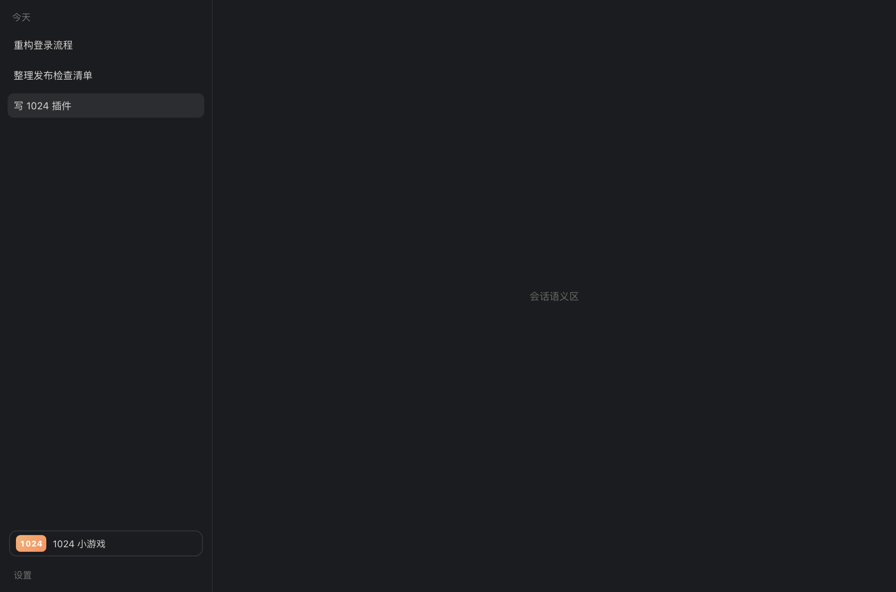
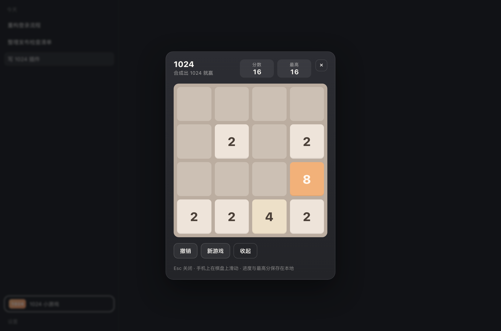

# dsh-1024-game

在 **DeepSeek Harness** 的 Web GUI 里直接玩 1024（2048 的 4×4 变体，合成出 1024 即达成）的客户端插件。

左侧栏底部多一个入口；点开是全屏游戏面板，方向键 / WASD 移动，手机上可滑动，进度与最高分存在本地。





## 玩法

- 方向键或 `WASD` 移动；手机在棋盘上滑动；`Esc` 关闭；`⌘/Ctrl + Z` 撤销一步。
- 同值方块相撞合并，一次移动里每块只合并一次；合并得分累加到分数。
- 合成出 `1024` 弹结算，可以「继续挑战」更高分；走不动时判定结束。
- 最高分、当前残局写入 `localStorage`，关掉面板或刷新页面都不丢局。
- 侧边栏收窄成图标栏时，入口自动变成只带 `1024` 徽标的方形按钮。

## 安装

插件是标准 DSH bundle：`package.json` 里同时声明宿主半包（`main`）与浏览器半包（`dsh.client` + `exports["./client"]`），`cordis.patch.yml` 插入一行 Loader row。

从 GitHub 安装（推荐）：

```
git+https://github.com/akiwu/dsh-1024-game.git
```

也接受 pnpm/npm 的简写：`github:akiwu/dsh-1024-game`。

在 DSH 里三种装法任选：

- 插件页的安装入口粘贴上面的 spec；
- 命令行 `dsh plugin add "git+https://github.com/akiwu/dsh-1024-game.git"`；
- 直接让 agent 调用 `plugin_manager` 的 `install_bundle`，`target` 填上面的 spec。

本机开发时用「本地路径安装」，DSH 会 `link:` 到项目目录，改完代码重新加载即生效：

```
# target 填项目的绝对路径，例如
plugin_manager install_bundle { target: "/path/to/DeepSeek1024" }
```

**安装/升级后需要重启一次 DSH**（宿主 Loader 的包解析在启动时定型），重启后侧边栏底部出现「1024 小游戏」。

卸载：插件页停用并移除 `dsh-1024-game`，或从 profile 的 `package.json` 中删掉该依赖与 `dsh.profile.bundles` 里的条目。

## 目录结构

```
lib/index.js          宿主半包：空 apply（只为让浏览器半包被 client-modules 发现）
lib/client.js         浏览器半包：__ModuleLoader__ 工厂式 bundle + 游戏逻辑 + 两个 slot 挂载
lib/…                 无需构建，直接就是 DSH 下发的 lib/client.js
cordis.patch.yml      bundle patch：插入 row { id: ui-1024-game, name: dsh-1024-game }
test/                 node:test 单测：纯逻辑 + 包契约（不依赖浏览器）
preview/              本地预览：用 Playwright/浏览器直接跑真实 bundle
scripts/screenshot.mjs 预览截图脚本
docs/screenshots/     README 用的截图
```

## 开发

```bash
npm test                     # 22 个用例：合并规则、四方向、胜负、撤销、持久化、包契约
node preview/build.mjs       # 生成 preview/bundle.js（借用同级项目的 esbuild + react）
open preview/index.html      # 不装 DSH 也能点着玩（本地预览桩）
node scripts/screenshot.mjs  # 重新生成 docs/screenshots/*.png
```

`preview/` 与 `scripts/` 只服务本地开发，不发布；插件本身零运行时依赖（只 `require("react")`，来自 DSH 平台基座模块表）。

## 实现要点

- **两个挂载点**（slot）：
  - `sidebar.footer.action` —— 左侧栏底部入口按钮，收到宿主给的 `wide`，宽栏显示文字、窄栏只显示徽标。
  - `shell.overlay` —— 全屏弹层，自带遮罩，未打开时渲染 `null`。
- 两个 slot 都用 `ctx.slots.inject(name, …)` 等待声明就绪再 `register`，随插件 fiber 卸载自动摘除；样式通过 `ctx.effect` 注入并在卸载时移除。
- 状态用模块内单例 store + `useSyncExternalStore` 订阅，关闭弹层不丢局；持久化键：`dsh-1024-game/state`、`dsh-1024-game/best`。
- 游戏逻辑是纯函数（`slideLine` / `moveBoard` / `spawnTile` / `canPlay` / `applyMove` / `undoMove`），全部有单测；组件只做渲染与事件。
- 兼容 React 18/19：只用 `createElement` 与 18 起可用的 hooks。

## 已知限制

- 只面向 Web 平台（Desktop 内置的也是 Web GUI）；终端 TUI 不显示。
- 无联网、无宿主工具，纯前端小游戏；不参与 agent 的对话与计费。
- 全屏弹层打开时会遮住整个 GUI（和设置弹窗同一层），点遮罩或 `Esc` 关闭。

## License

MIT
