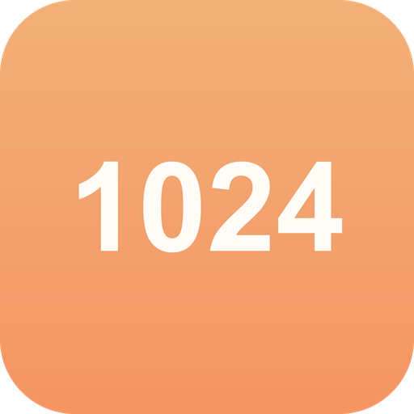
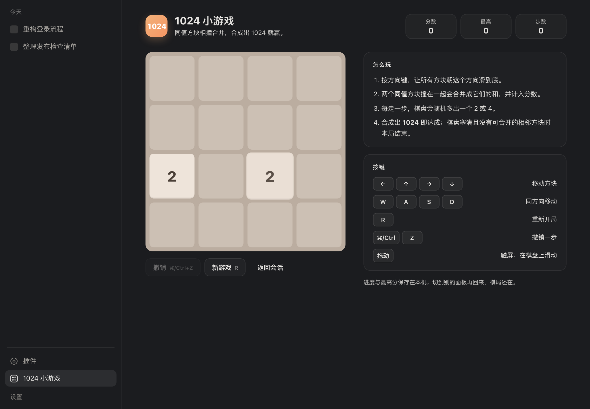
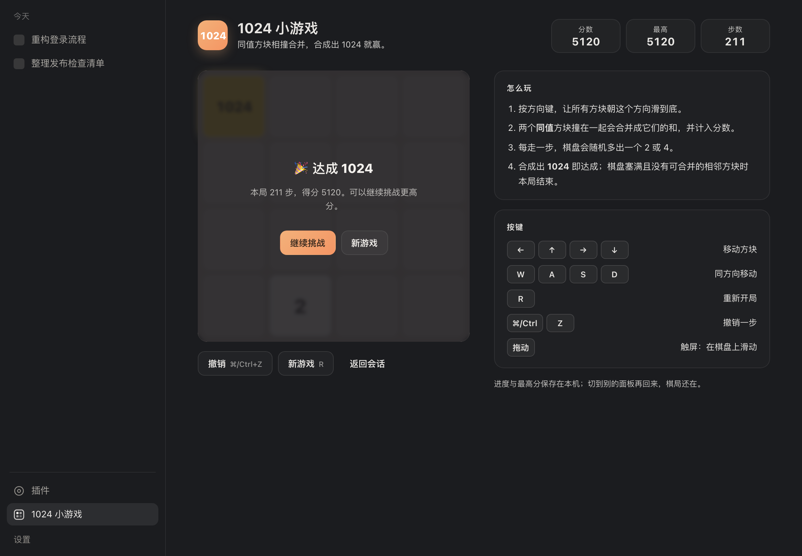

<p align="center">
  
</p>

# dsh-1024-game

在 **DeepSeek Harness** 的 Web GUI 里直接玩 1024（2048 的 4×4 变体，合成出 1024 即达成）的客户端插件。

入口在左侧栏的面板列表里、和「插件」并排（`1024 小游戏`）；点进去是一个独立的主面板页面，棋盘、计分和按键说明都在页面里，不再是盖住整个客户端的弹层。





## 玩法

| 按键 | 作用 |
|---|---|
| `←` `↑` `→` `↓` | 让所有方块朝该方向滑到底 |
| `W` `A` `S` `D` | 同上 |
| `R` | 重新开局 |
| `⌘ / Ctrl` + `Z` | 撤销一步（最多回退 32 步） |
| 在棋盘上拖动（触屏/触控板） | 滑动移动 |

规则：两个**同值**方块相撞合并成它们的和并计分，一次移动里每块只合并一次；每走一步随机多出一个 2 或 4；合成出 `1024` 达成，可以「继续挑战」；棋盘塞满且没有可合并的相邻方块时本局结束。

最高分与残局写入 `localStorage`：切到别的面板再回来、刷新页面都不丢局。键盘监听只在这个面板挂载时存在，回到会话后不会抢输入框的按键。

## 安装（给别人用）

> 给同事的极简版：见 [INSTALL.md](INSTALL.md)（Desktop / 命令行 / 离线 tarball 三种装法 + 排障）。


**不需要发布 npm。** DSH 的插件管理器直接从 GitHub 装，Release 里还有预打包 tarball；收录进市场后更是点一下就行。按省事程度排：

**方式 1 · 一行 spec（现在就能用）**，粘到 DSH 插件页的安装入口 / `dsh plugin add` / agent 的 `plugin_manager.install_bundle`：

```
github:akiwu/dsh-1024-game
```

等价的长写法：`git+https://github.com/akiwu/dsh-1024-game.git`（想锁版本加 `#v0.1.2`）。

**方式 2 · 预打包 tarball**（不拉仓库、不需要构建授权，适合网络不稳）：

```
https://github.com/akiwu/dsh-1024-game/releases/latest/download/dsh-1024-game.tgz
```

**方式 3 · 市场一键安装**（收录之后）：在 dsh-market 或 DSH 的 Discover 里搜「1024」，点安装。

**命令行等价操作：**

```sh
dsh plugin add "github:akiwu/dsh-1024-game"
```

**本机开发**用「本地路径安装」，DSH 会 `link:` 到项目目录，改完代码重新加载即生效：

```
plugin_manager install_bundle { target: "/path/to/DeepSeek1024" }
```

**装完重启一次 DSH**（宿主 Loader 的包解析在启动时定型），之后侧边栏底部出现「1024 小游戏」。

卸载：插件页停用并移除 `dsh-1024-game`，或从 profile 的 `package.json` 删掉该依赖与 `dsh.profile.bundles` 里的条目。

> npm 是可选的：不发布也能被收录、被安装（收录登记处明确写着这一点）。发布 npm 的唯一收益是市场能显示下载量、安装免构建。这个包的 `lib/` 是提交进仓库的预构建产物，所以从 git 安装也不需要任何构建步骤。

## 插件市场

DSH 没有内置的官方市场：Discover 页读的是**你自己添加的索引 URL**（格式 1 的 JSON）。社区里最常用的两个是：

- [dsh-market](https://github.com/dsh-market/dsh-market)（[dshmarket.com](https://dshmarket.com)，10k+ stars）——装进 DSH 后是 Plugins 页上的一个 tab，目录来自下面的 awesome 列表；它同时把整份目录发布成索引：在 **Plugins → Discover → Index sources** 添加 `https://cdn.jsdelivr.net/npm/dsh-plugin-catalog/index.json` 就能被原生 Discover 搜到。
- [awesome-dsh-plugin](https://github.com/awesome-dsh-plugin/awesome-dsh-plugin)（22.3k★）——社区插件登记处，`data/plugins/<owner>__<repo>.yml` 一个插件一个文件，提 PR 合并后站点与 dsh-market 通常一天内自动收录。

本仓库的收录材料已准备好：`catalog/akiwu__dsh-1024-game.yml`（分类 `fun`，带图标）。按登记处规则，仓库需创建满 1 天后才接受 PR，所以上游 PR 在创建次日提交。

## 目录结构

```
lib/index.js          宿主半包：空 apply（只为让浏览器半包被 client-modules 发现）
lib/client.js         浏览器半包：__ModuleLoader__ 工厂式 bundle + 游戏逻辑 + 两个 slot 挂载
lib/…                 无需构建，直接就是 DSH 下发的 lib/client.js
cordis.patch.yml      bundle patch：插入 row { id: ui-1024-game, name: dsh-1024-game }
test/                 node:test 单测：纯逻辑 + 包契约（不依赖浏览器）
preview/              本地预览：用 Playwright/浏览器直接跑真实 bundle
scripts/screenshot.mjs 预览截图脚本
docs/screenshots/     README 用的截图
```

## 开发

```bash
npm test                     # 22 个用例：合并规则、四方向、胜负、撤销、持久化、包契约
node preview/build.mjs       # 生成 preview/bundle.js（借用同级项目的 esbuild + react）
open preview/index.html      # 不装 DSH 也能点着玩（本地预览桩）
node scripts/screenshot.mjs  # 重新生成 docs/screenshots/*.png
```

`preview/` 与 `scripts/` 只服务本地开发，不发布；插件本身零运行时依赖（只 `require("react")`，来自 DSH 平台基座模块表）。

## 实现要点

- **两个挂载点**（slot）：
  - `main`（keyed，`key = "1024-game"`）——主面板本体，只有被选中时才挂载，键盘/触摸监听随挂载存亡。
  - `sidebar.panellist`（list，`id = "1024-game"`）——左侧栏面板列表里的图标入口，与「插件」并列；点击由侧边栏调用 `ctx.layout.selectPanel(id)`。
- 面板里的「返回会话」调用 `ctx.layout.selectPanel(null)`，不改变当前 Session。
- 样式通过 `ctx.effect` 注入 `<style>` 并在卸载时移除；配色读 `--dsw-alias-*` 主题变量，浅色/深色主题都跟随。
- 状态用模块内单例 store + `useSyncExternalStore` 订阅；持久化键：`dsh-1024-game/state`、`dsh-1024-game/best`。
- 游戏逻辑是纯函数（`slideLine` / `moveBoard` / `spawnTile` / `canPlay` / `applyMove` / `undoMove`），全部有单测；组件只做渲染与事件。
- 兼容 React 18/19：只用 `createElement` 与 18 起可用的 hooks。

## 已知限制

- 只面向 Web 平台（Desktop 内置的也是 Web GUI）；终端 TUI 不显示。
- 无联网、无宿主工具，纯前端小游戏；不参与 agent 的对话与计费。
- 打开游戏面板会替换中间栏的会话视图（和「插件」页一样），会话本身不受影响。

## License

MIT
